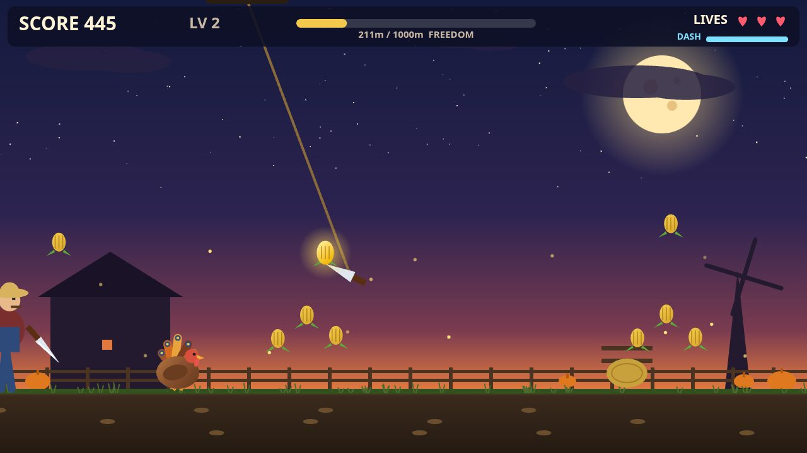

[](https://make.fun/c/turkey-run-game-01)
[](https://make.fun/c/turkey-run-game-01)
[](https://make.fun/c/turkey-run-game-01)

# Giblet's Great Escape

Thanksgiving night. The farmer has the carving knife out, the oven is already
hot, and you are **Giblet** — the turkey. Run **1000 metres** of moonlit farm
to freedom, or end up as dinner.

An entry for the [make.fun turkey escape game bounty](https://make.fun/c/turkey-run-game-01).



## How to play

Open `game/index.html` in a desktop browser, or serve the folder and open it:

```sh
node serve.ts
# then open http://localhost:8080
```

- **SPACE / ↑ / W / CLICK** — jump (hold for a higher jump, release early to cut it short)
- **SHIFT / X** — **Gobble Dash**: a burst of speed that smashes straight through one obstacle, while your dash meter holds out
- **P** — pause · **M** — mute · **SPACE** — restart after the end screen

Jump the glowing **ovens** (the farmer dragged one outside, still hot), the
**hay bales and fences**, and the **carving knives** skimming the dirt. Run
*under* the **swinging blade** hanging from the old oak — jumping into it is
exactly what it wants. Eat **corn** to charge your dash; a golden cob fills it
completely. Corn also distracts the farmer and buys you a few steps.

The farmer never stops walking. Every hit lets him lunge closer, and the
warning flashes when he is right behind you. Three hits — or one grab — and
dinner is served. Reach 1000 m and Giblet lives to gobble another day.

## What is in the farm

- A living Thanksgiving night: harvest moon, drifting clouds, twinkling stars,
  fireflies, a barn, a turning windmill, a pumpkin patch and a fence line that
  scrolls past for a thousand metres.
- Four hazards with four answers: jump the oven, the fence and the flying
  knife; run under the swinging blade; dash through anything once.
- A chase, not a timer: the farmer closes in every second and lunges on every
  hit, so corn is both points and breathing room.
- Levels that quicken the farm every 15 seconds, a distance bar to freedom,
  hearts, a dash meter, and a best score kept between visits.
- Synthesised WebAudio sound (gobbles, dash whoosh, corn pings, escape
  fanfare) — made at run time, no audio files, no network.
- Deterministic staged screenshots: `?shot=title|play|dash|end&seed=N` plays
  the real rules forward with a seeded autopilot, so every frame is a real
  game, repeatable to the pixel.

## Files

- `game/` — the playable game, plain static files: `index.html` plus
  `src/config.js` (tuning), `src/world.js` (rules), `src/render.js`
  (drawing), `src/input.js`, `src/audio.js`, `src/shots.js`, `src/main.js`
- `screenshots/` — 4 real renders of the game's own code (cover first)
- `main.ts` — the hand-in program: copies `game/` and `screenshots/` to
  `/output` and writes `dossier.json` with the kit's vendored library
- `serve.ts` — a tiny static server for local play-testing
- `tools/shoot.py` — the headless-Chromium screenshot script used for
  `screenshots/`
